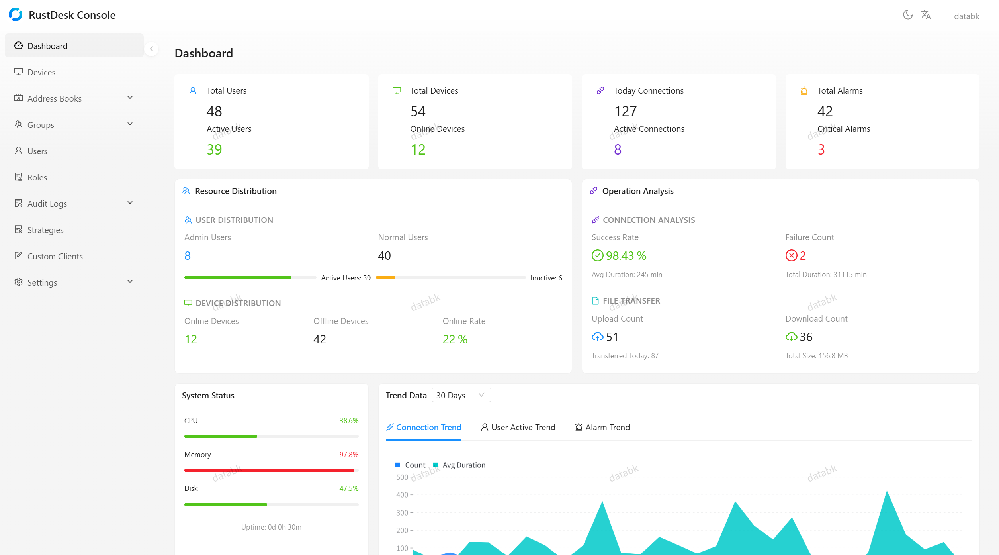
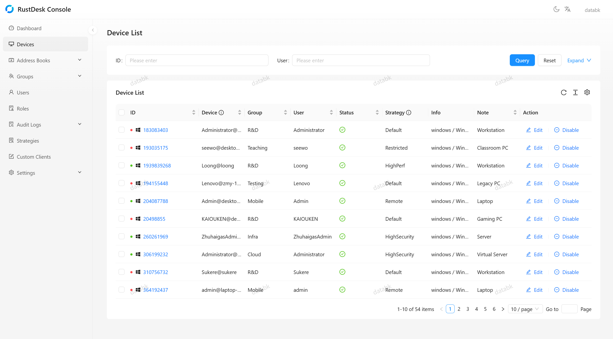

<h1 align="center">
  <br>
  <a href="https://github.com/databk/rustdesk-console"></a>
  <br>
  RustDesk Console 中文手册
  <br>
</h1>
<div align="center">

**面向 RustDesk 生态的企业级管理平台**

[](LICENSE)
[](https://nodejs.org/)
[](https://nestjs.com/)
[](https://hub.docker.com/r/databk/rustdesk-console)

[English](README.md) · [简体中文](README.zh-CN.md) · [Discord](https://discord.gg/vrQSJfqpwD) · [前端项目](https://github.com/databk/rustdesk-console-web)

</div>

---

> 本手册根据仓库中的英文文档整理，目的是让中文用户能够独立完成部署、初始化和日常运维。
> 如中文手册与英文文档存在差异，请以英文文档和实际代码为准，并欢迎提交 Issue 或 PR 指正。

## 📖 目录

- [这是什么](#这是什么)
- [功能概览](#功能概览)
- [部署方式怎么选](#部署方式怎么选)
- [方式一：Docker Compose（推荐）](#方式一docker-compose推荐)
- [方式二：Docker CLI](#方式二docker-cli)
- [方式三：预编译二进制](#方式三预编译二进制)
- [方式四：从源码构建](#方式四从源码构建)
- [配置项说明](#配置项说明)
- [首次登录与初始化](#首次登录与初始化)
- [界面菜单对照](#界面菜单对照)
- [日常使用](#日常使用)
- [集成 hbbs / hbbr 服务器管理](#集成-hbbs--hbbr-服务器管理)
- [网页远控（Web 客户端）](#网页远控web-客户端)
- [系统更新](#系统更新)
- [数据备份与恢复](#数据备份与恢复)
- [反向代理与 HTTPS](#反向代理与-https)
- [常见问题](#常见问题)
- [目录与文件](#目录与文件)
- [相关文档](#相关文档)
- [贡献与许可](#贡献与许可)

## 这是什么

RustDesk Console 是一个可自建的 RustDesk 管理控制台，用于替代 RustDesk Server Pro 的集中管理能力。前端内置简体中文界面，可在右上角的语言菜单中切换。它由两部分组成：

- **后端**（本仓库）：NestJS + TypeORM，提供 API、鉴权、设备与用户管理、审计、更新等能力。
- **前端**（[rustdesk-console-web](https://github.com/databk/rustdesk-console-web)）：浏览器管理界面，默认通过 `21114` 端口访问。

Console 不替代 hbbs/hbbr。它管理的是"谁可以使用、能管理哪些设备、操作留下什么记录"；实际的远程连接仍由 RustDesk 的 ID 服务器（hbbs）和中继服务器（hbbr）完成，客户端协议保持兼容。

## 功能概览

| 模块 | 能力 |
| --- | --- |
| 🔐 认证与安全 | JWT、TOTP 两步验证、OIDC 单点登录、Passkey、邮箱验证、登录限流 |
| 📱 设备管理 | 设备分组、在线状态、策略下发、批量操作、强制断开 |
| 📋 地址簿 | 个人地址簿与共享地址簿、标签整理、设备条目管理、访问规则 |
| 🎯 策略配置 | 按设备 / 用户 / 用户组分配策略，按优先级解析，心跳下发 |
| 📊 仪表盘 | 总览统计、趋势分析、实时监控、多指标展示 |
| 🔍 审计与合规 | 连接、文件传输、安全告警、控制台操作日志 |
| 🖥️ 服务器管理 | 在 Console 内管理 hbbs/hbbr 节点、中继与密钥 |
| 🌐 Web 客户端 | 在浏览器中发起受控的远程桌面与文件传输 |

> 界面截图见[下方](#界面截图)。

### 界面截图

| 仪表盘 | 设备管理 |
| --- | --- |
|  |  |
| **个人地址簿** | **文件传输审计** |
|  |  |

## 部署方式怎么选

| 方式 | 适合场景 | 是否支持界面内自动更新 |
| --- | --- | --- |
| Docker Compose | 生产环境首选，Linux Docker 主机 | ✅ 支持 |
| 预编译二进制 + `install-linux.sh` | 全新 Linux + systemd 主机，不想依赖 Docker | ✅ 支持 |
| Docker CLI 手动运行 | 临时测试、已有自定义编排 | ❌ 手动更新 |
| 源码运行 | 开发、二次开发 | ❌ 手动更新 |
| Windows / macOS 二进制 | 本地试用 | ❌ 手动更新 |

> "自动更新"指管理员在 **系统更新**（System update）中触发受控更新。它只接受官方稳定版、且后端与前端版本互相兼容；启动时不会自动升级。

## 方式一：Docker Compose（推荐）

### 1. 准备文件

在 Linux Docker 主机上新建一个专用目录，例如 `/opt/rustdesk-console-compose`，下载以下三个文件到该目录：

- [`docker-compose.yml`](docker-compose.yml)
- [`docker-compose.override.yml`](docker-compose.override.yml)
- [`.env.example`](.env.example)

### 2. 生成配置

```bash
cd /opt/rustdesk-console-compose
cp .env.example .env
chmod 600 .env
```

编辑 `.env`，至少设置以下三项：

```dotenv
# 随机生成，例如：openssl rand -hex 32
JWT_SECRET=请替换为足够长的随机字符串

# 初始超级管理员密码，首次启动时使用
ADMIN_PASSWORD=请替换为强密码

# 必须是本目录在宿主机上的绝对路径
CONSOLE_INSTALL_DIR=/opt/rustdesk-console-compose
```

说明：

- `CONSOLE_INSTALL_DIR` 必须与实际目录完全一致。注册自动更新后不要移动或重命名该目录。
- `docker-compose.override.yml` 由更新器维护，初始内容应为 `services: {}`，不要把自己的配置写进去。
- 路径尽量短。更新器使用的 Unix socket 路径必须短于 108 个 UTF-8 字节。

### 3. 启动

```bash
docker compose up -d
```

启动后访问：

```text
http://服务器IP:21114
```

默认会启动三个容器：

| 容器 | 作用 |
| --- | --- |
| `rustdesk-console` | 后端 API（容器内 `3000` 端口，不直接对外） |
| `rustdesk-console-web` | 前端 Nginx，映射到宿主机 `21114` |
| `updater` | 受控更新器，挂载 Docker socket 但默认不会自动升级 |

### 4. 同时部署 RustDesk 服务端（可选）

如果还没有 hbbs/hbbr，可以让 Compose 一并启动：

```dotenv
COMPOSE_PROFILES=server
RUSTDESK_RELAY_ADDRESS=relay.example.com:21117
SERVER_MANAGEMENT_TOKEN=至少32位随机字符串
```

然后重新执行 `docker compose up -d`。详见[集成 hbbs / hbbr](#集成-hbbs--hbbr-服务器管理)。

### 5. 生产环境注意事项

- 不要直接把未加密的 `21114` 暴露到公网。请在前面放 HTTPS 反向代理。
- 首次登录后立即修改默认管理员密码。
- 保护好 `.env`、`data/`、`updater-state/` 和备份文件。
- 后端以 UID/GID `1000` 运行，`data/` 需要对该账号可写。
- 只有 `updater` 和更新任务容器挂载 Docker socket，不要把这些目录再挂进业务容器。

## 方式二：Docker CLI

适合快速验证。这种方式没有受控更新器，后续需要手动更新镜像。

```bash
docker network create rustdesk-net

docker run -d \
  --name rustdesk-console \
  --network rustdesk-net \
  -e JWT_SECRET=your-super-secret-key \
  -v ./data:/data \
  databk/rustdesk-console:latest

docker run -d \
  --name rustdesk-console-web \
  --network rustdesk-net \
  -p 21114:80 \
  -e BACKEND_URL=http://rustdesk-console:3000 \
  databk/rustdesk-console-web:latest
```

镜像同时发布在 Docker Hub（`databk/rustdesk-console`）和 GitHub Container Registry（`ghcr.io/databk/rustdesk-console`），支持 `linux/amd64` 与 `linux/arm64`。国内拉取困难时可尝试 GHCR 镜像。

## 方式三：预编译二进制

每次发布都会提供 SEA（Single Executable Application）压缩包：

- Linux：x64 / arm64（注意选择匹配的 libc）
- Windows：x64
- macOS：x64 / arm64

从 [Releases](https://github.com/databk/rustdesk-console/releases) 下载对应包，并核对发布页的 SHA-256。解压后请保留完整目录（包含原生模块和模板），不需要另外安装 Node.js。

**全新 Linux + systemd 主机**可以执行：

```bash
sudo ./deployment/install-linux.sh
```

安装器会一并安装后端、前端、依赖工具和更新服务。初始凭据保存在仅 root 可读的 `/etc/rustdesk-console/backend.env` 中。

可选参数：

```bash
sudo ./deployment/install-linux.sh \
  --backend-tag <后端版本> \
  --web-tag <前端版本> \
  --config <初始配置文件>
```

安装器要求全新的主机布局，已存在的数据、配置、服务文件或 release 链接会被拒绝。详细说明见 [标准 Linux 安装](docs/system-update.md#standard-linux-installation)。

**直接运行可执行文件、源码部署、Windows/macOS** 使用手动更新流程。手动启动前先执行迁移：

```bash
./rustdesk-console migrate
```

升级前务必备份数据库。

## 方式四：从源码构建

要求：Node.js ≥ 20.0.0，npm ≥ 9.0.0。

```bash
git clone https://github.com/databk/rustdesk-console.git
cd rustdesk-console
npm install
cp .env.example .env
# 编辑 .env
npm run build
node dist/main.js migrate
npm run start:prod
```

开发模式与常用命令：

| 命令 | 作用 |
| --- | --- |
| `npm run start:dev` | 监听文件变化启动 |
| `npm run lint` | 运行 ESLint（自动修复） |
| `npm run format` | 运行 Prettier |
| `npm test` | 单元测试 |
| `npm run test:cov` | 带覆盖率的测试 |
| `npm run test:e2e` | 端到端测试 |
| `npm run build` | 生产构建 |
| `npm run db:migrate` | 构建并执行数据库迁移 |
| `npm run db:show` | 查看未执行的迁移 |

## 配置项说明

以下是最常用的环境变量。完整示例见 [`.env.example`](.env.example)。

### 基础配置

| 变量 | 默认值 | 说明 |
| --- | --- | --- |
| `PORT` | `3000` | 后端监听端口 |
| `JWT_SECRET` | 无（生产必须设置） | JWT 签名密钥，泄漏后需立即更换并使所有会话失效 |
| `ADMIN_PASSWORD` | 无 | 首次初始化时创建的 `databk` 管理员密码 |
| `DATA_DIR` | `./data` | 数据目录，存放 SQLite 数据库、头像、Nexus 构建产物等 |
| `DEVICE_CLONE_ISOLATION` | `false` | 是否按 `(UUID, RustDesk ID)` 区分克隆客户端，见 [clone-isolation.md](docs/clone-isolation.md) |

> 旧版本在没有设置 `ADMIN_PASSWORD` 时会使用默认密码 `databk`。新部署请始终显式设置，并在首次登录后修改。

### 数据库

| 变量 | 默认值 | 说明 |
| --- | --- | --- |
| `DB_TYPE` | `sqlite` | `sqlite` 或 `mysql` |
| `DB_HOST` | `localhost` | MySQL 主机 |
| `DB_PORT` | `3306` | MySQL 端口 |
| `DB_USERNAME` | `root` | MySQL 用户名（Compose 默认 `rustdesk_console`） |
| `DB_PASSWORD` | 空 | MySQL 密码 |
| `DB_DATABASE` | `rustdesk_console` | 数据库名 |

使用 MySQL 时：

- 需要 MySQL 8.0.13 或更高版本。
- 自动更新要求该 schema 专用于本应用，并显式设置 `SYSTEM_UPDATE_MYSQL_EXCLUSIVE_SCHEMA=true`。
- 多副本部署时，先单独执行一次迁移，再给所有副本设置 `DB_MIGRATE_ON_START=0`。

### Compose 与服务端

| 变量 | 说明 |
| --- | --- |
| `CONSOLE_INSTALL_DIR` | Compose 项目目录的宿主机绝对路径，自动更新必需 |
| `COMPOSE_PROFILES` | 设为 `server` 时一并启动 hbbs/hbbr |
| `RUSTDESK_RELAY_ADDRESS` | 对外公布的中继地址，例如 `relay.example.com:21117` |
| `SERVER_MANAGEMENT_TOKEN` | hbbs/hbbr 管理令牌，至少 32 位随机字符 |
| `SYSTEM_UPDATE_MYSQL_EXCLUSIVE_SCHEMA` | 确认 MySQL schema 专用于本应用 |
| `SYSTEM_UPDATE_INSTALLATION` | 更新器安装记录路径，由标准部署生成 |
| `SYSTEM_UPDATE_SOCKET` | 更新器 Unix socket 路径，由标准部署生成 |
| `SYSTEM_UPDATE_MAINTENANCE_FILE` | 维护栅栏文件路径，由标准部署生成 |
| `SYSTEM_UPDATE_COMPOSE_ROOT` | Compose 项目根目录 |
| `SYSTEM_UPDATE_SOCKET_GID` | 可访问更新器 socket 的组 ID，默认 `1000` |
| `SOURCE_COMMIT` | 由官方构建注入，生产环境不要覆盖 |

## 首次登录与初始化

1. 浏览器打开 `http://服务器IP:21114`。
2. 用户名固定为 `databk`，密码为 `.env` 中的 `ADMIN_PASSWORD`。
3. 如果数据库已经初始化过，修改 `.env` 中的 `ADMIN_PASSWORD` 不会重置现有账号密码。
4. 登录后立即：
   - 修改超级管理员密码；
   - 按需配置 SMTP（用于邮箱验证和找回密码）；
   - 按需配置 OIDC / LDAP；
   - 创建角色和用户组，不要长期共用 `databk` 账号。

> 如果忘记了超级管理员密码：控制台中保存的是 bcrypt 哈希，无法"查看"原密码。请优先通过已配置的 SMTP 使用"忘记密码"流程；没有邮件服务时，需要由部署管理员恢复数据库备份或按运维流程处理。

## 界面菜单对照

右上角语言菜单可以切换 **简体中文** 和 **English**。下表同时列出中文界面与英文界面的名称，方便对照英文文档和社区教程：

| 中文界面 | 英文界面 | 说明 |
| --- | --- | --- |
| 仪表盘 | Dashboard | 设备、连接、告警等总览 |
| 设备管理 | Devices | 设备列表、分组、策略、批量操作 |
| 地址簿 → 个人地址簿 | Address Books → Personal | 当前用户的个人地址簿 |
| 地址簿 → 共享地址簿 | Address Books → Shared | 按规则共享给用户/组的地址簿 |
| 用户管理 | Users | 用户管理、启禁用、所属用户组 |
| 审计日志 → 连接审计 | Audit Logs → Connection | 远程连接记录 |
| 审计日志 → 文件审计 | Audit Logs → File Transfer | 文件传输记录 |
| 审计日志 → 告警审计 | Audit Logs → Alarm | 安全告警 |
| 审计日志 → 控制台审计 | Audit Logs → Console | 管理操作记录 |
| 角色管理 | Roles | 权限与设备组范围 |
| 策略管理 | Strategies | 设备/用户/组策略配置 |
| 组管理 → 用户组 | Groups → User Groups | 用户分组 |
| 组管理 → 设备组 | Groups → Device Groups | 设备分组 |
| 设置 → 常规设置 | Settings → General Settings | 站点与通用配置 |
| 设置 → SMTP 配置 | Settings → SMTP Configuration | 邮件服务 |
| 设置 → OIDC 提供商 | Settings → OIDC Providers | 单点登录提供商 |
| 设置 → LDAP 配置 | Settings → LDAP Configuration | LDAP 目录 |
| 设置 → 网页客户端 | Settings → Web Client | 浏览器远控网关 |
| 设置 → 服务器管理连接 | Settings → Server Management | hbbs/hbbr 连接配置 |
| 自定义客户端 | Custom Clients | 定制客户端构建 |
| 个人中心 | Account | 个人资料、密码、两步验证 |

## 日常使用

### 设备

- 客户端需要在 RustDesk 中把 ID 服务器指向你的 hbbs，设备才会注册到 Console。
- 设备可以分配到**设备组**，角色再按设备组授权，实现"只能看/只能连自己组的设备"。
- 支持批量操作和强制断开。强制断开依赖客户端在线且心跳正常。

### 用户、用户组与角色

- 每个用户只能属于一个**用户组**；删除用户组时，成员会移动到默认组，相关地址簿授权会一并清理。
- 用户组与设备组是两套概念，不要混淆。
- **角色**决定权限和设备范围。除系统所有者外，普通用户必须显式获得权限。
- 网页远控还需要单独的 `web_client.connect`（文件传输另需 `web_client.file_transfer`），详见[网页远控](#网页远控web-客户端)。

### 地址簿

- 个人地址簿只对本人可见。
- 共享地址簿可以授权给用户或用户组。
- 地址簿条目引用设备，但仍受角色和设备范围约束，不能借此绕过设备权限。

### 策略

- 策略可以分配给设备、用户或用户组。
- 多个来源冲突时按优先级解析，最终通过心跳下发给客户端。
- 修改策略后，等待客户端下一次心跳生效；离线设备不会立即应用。

### 审计

- 连接、文件传输、安全告警、控制台操作分别记录。
- 审计日志用于追踪"谁在什么时候对哪台设备做了什么"。
- 排查问题时，优先查看 Console 审计日志和 hbbs/hbbr 容器日志。

## 集成 hbbs / hbbr 服务器管理

Console 通过 hbbs 的管理 API（`/v1`）管理整个服务端。hbbr 通过出站 WebSocket 注册到 hbbs，再由 hbbs 代理，因此 Console 只需要**一个地址和一个令牌**，不需要每台节点装 agent，也不需要挂载 Docker socket。

### 使用 Compose 的 `server` profile

在 `.env` 中设置：

```dotenv
COMPOSE_PROFILES=server
RUSTDESK_RELAY_ADDRESS=relay.example.com:21117
SERVER_MANAGEMENT_TOKEN=至少32位随机字符串
```

然后：

```bash
docker compose up -d
```

这会额外启动两个容器：

- **hbbs**：启用管理 API（`RD_MANAGEMENT_BIND=0.0.0.0:21120`），密钥、`db_v2.sqlite3` 和管理数据保存在 `./data/server`。
- **hbbr**：通过 `ws://hbbs:21120/v1/control` 注册，数据保存在 `./data/server-relay`。

### 在 Console 中填写服务器管理

登录后进入 **设置 → 服务器管理连接**（Settings → Server Management）：

| 字段 | Compose 部署建议值 |
| --- | --- |
| 管理地址（hbbs URL） | `http://hbbs:21120` |
| 管理令牌 | 与 `.env` 中的 `SERVER_MANAGEMENT_TOKEN` 相同 |
| 节点 ID | 该 hbbs 节点的标识 |
| 节点名称 | 仅用于界面显示，可自定义 |

说明：

- 地址为空时，服务器管理功能处于禁用状态。
- 如果修改了令牌，必须同时更新 `.env` 中的 `SERVER_MANAGEMENT_TOKEN` 并重启 hbbs/hbbr，否则两边凭据不一致。
- 中继节点 ID 不要与主节点 ID 重复。即使重复，Console 也会把它显示为该节点的 `hbbr` 服务，但建议明确区分。
- 服务端版本需要包含管理 API（高于 `1.0.1`）。

### 端口

| 端口 | 协议 | 用途 | 是否对公网开放 |
| --- | --- | --- | --- |
| `21115` | TCP | NAT 类型测试 | 按需 |
| `21116` | TCP/UDP | ID 注册与心跳 | 是 |
| `21117` | TCP | 中继 | 是 |
| `21118` | TCP | WebSocket（ID） | 通常仅内网/反代 |
| `21119` | TCP | WebSocket（中继） | 通常仅内网/反代 |
| `21120` | TCP | hbbs 管理 API | **否**，仅 Compose 内网 |

生产环境建议：

- 在 `21114` 前放 HTTPS 反向代理，不要让明文登录暴露在公网。
- `21120` 不要发布到宿主机。
- 启用自动更新后不要随意修改 Compose 端口映射，配置漂移会阻止更新执行。
- 受控更新器不会启动、停止或升级 hbbs/hbbr。

### 从旧版布局迁移

早期 Compose 定义把 `/data` 挂载到容器，但镜像实际把 `/root` 作为工作目录和 HOME，密钥、对等端数据库可能留在容器可写层。直接重建容器可能永久丢失节点身份。

迁移前务必：

1. 安排维护窗口；
2. **不要**先执行 `up`、`down`、`rm`、镜像升级或容器清理；
3. 保留原容器和原镜像，直到验证完成；
4. 备份时同时复制 `/root` 与 `/data`，SQLite 还要复制 `-wal`、`-shm`、`-journal` 文件；
5. 备份包含私钥和凭据，必须妥善保管。

完整命令和校验脚本见 [Server management → Migrating an existing server profile](docs/server-management.md#migrating-an-existing-server-profile)。

## 网页远控（Web 客户端）

网页远控由 Console 发放短期授权，再通过透明 WebSocket 网关连接现有 hbbs/hbbr。网关不解密密码、画面、聊天或文件内容。

启用步骤概要：

1. 超级管理员登录 Console；
2. 进入 **设置 → 网页客户端**（Settings → Web Client）；
3. 填写允许的来源（完整 HTTPS origin）、公开的 `wss://` ID/中继地址、服务器公钥等；
4. 给角色分配 `web_client.connect`，文件传输再加 `web_client.file_transfer`；
5. 配置反向代理，将 `/api/web-client/socket` 的 WebSocket Upgrade 转发到 Console；
6. 关闭浏览器直通 hbbs/hbbr 的旁路。

详细字段、角色范围、审计边界和 Nginx 示例见：

- [网页远控的角色授权与审计](docs/web-client-integration.zh-CN.md)
- [Web 客户端网关部署说明](deploy/web-client-gateway/README.zh-CN.md)

> 仅填写设置表单不够，反向代理必须正确转发 WebSocket。只完成设置表单会导致连接失败。

## 系统更新

管理员在 **系统更新**（System update）中触发更新。更新器会把后端和前端更新到一对兼容的官方稳定版本；已经是目标版本的组件不会重复更新。启动时不会自动升级。

支持受控更新的部署：

- 标准 Docker Compose 部署
- 标准 Linux + systemd 安装（`install-linux.sh`）

其他部署（直接运行可执行文件、源码、Windows/macOS）需要手动更新，并在启动前执行数据库迁移。

### 更新做了什么

1. 校验正在运行的 Compose 服务、挂载、配置哈希、官方 manifest 和镜像 digest；
2. 下载并验证目标版本；
3. 进入维护模式，阻止新的业务请求和后台写入；
4. 备份数据库和业务文件；
5. 切换版本并执行目标版本的迁移；
6. 启动并验证；失败时在可恢复的前提下回滚。

### 注意事项

- 更新前仍建议自行做一次可验证的备份。
- MySQL 备份需要应用 schema 的读取/恢复权限；密码通过受保护的 option file 传递，不会出现在命令行。
- 更新不会执行项目级 `down`、不会删除 volume、不会升级 MySQL、不会改动 hbbs/hbbr。
- 不要随意修改 `CONSOLE_INSTALL_DIR`、Compose 文件、`.env` 或挂载；配置漂移会阻止更新。
- 更新器与任务容器需要 Docker socket，这等同于宿主机控制权限。保护好部署目录和 `.env`。
- 如果出现 `recovery_required`，不要删除锁、清理维护标记或替换数据来"绕过"。Linux 使用 `sudo rustdesk-console-recover JOB_UUID`，Docker 使用记录下来的不可变后端镜像和 `--system-update-mode=recover --job-id=JOB_UUID`。

完整说明见 [Managed system updates](docs/system-update.md)。

## 数据备份与恢复

### SQLite

默认数据库文件：

```text
data/rustdesk-console.db
```

备份步骤：

1. 停止后端写入（最好停止服务）；
2. 复制 `rustdesk-console.db`；
3. 如果存在 `rustdesk-console.db-wal`、`-shm`、`-journal`，一并复制；
4. 同时备份 `DATA_DIR` 中的业务文件（头像、Nexus 构建产物等）。

也可以在服务运行时使用 SQLite 的在线备份 API，但不要直接复制正在写入的数据库文件。

### MySQL

使用常规的一致性备份工具导出应用 schema，并同时备份 `DATA_DIR` 中的业务文件。恢复前先在测试环境验证备份可用。

### 恢复

- 手动部署：停止服务 → 恢复数据库和业务文件 → 启动服务 → 执行 `migrate` 确认没有待执行迁移。
- 受控更新：使用更新器保留的备份和恢复流程，不要用旧快照覆盖已经确认提交后的新写入。
- 迁移到新机器：保持 `DATA_DIR` 内容完整，同时带走 `.env`、Compose 文件和密钥；如果使用自动更新，`CONSOLE_INSTALL_DIR` 必须保持相同绝对路径，或在恢复后重新注册。

### 数据库迁移

服务启动前如果有未执行的迁移，应用会拒绝启动。手动部署的流程：

```bash
# 源码部署
node dist/main.js migrate
node dist/main.js show-migrations

# 独立可执行文件
./rustdesk-console migrate
./rustdesk-console show-migrations
```

多副本共享 MySQL 时，先单独运行一次迁移，再给所有副本设置 `DB_MIGRATE_ON_START=0`。详见 [Database migrations](docs/database-migrations.md)。

## 反向代理与 HTTPS

生产环境建议至少做到：

- 用 Nginx/Caddy/Traefik 在 `21114` 前终止 TLS；
- 强制 HTTPS；
- 保留 `Host`、`X-Forwarded-For`、`X-Forwarded-Proto`；
- 为 `/api/web-client/socket` 转发 WebSocket Upgrade；
- 不要缓存 API 和 WebSocket；
- 不要把 `21120`、`21118`、`21119` 直接暴露给公网。

Nginx 的最小示例（仅示意，请按实际域名和路径调整）：

```nginx
server {
    listen 443 ssl http2;
    server_name console.example.com;

    ssl_certificate     /etc/letsencrypt/live/console.example.com/fullchain.pem;
    ssl_certificate_key /etc/letsencrypt/live/console.example.com/privkey.pem;

    location / {
        proxy_pass http://127.0.0.1:21114;
        proxy_http_version 1.1;
        proxy_set_header Host $host;
        proxy_set_header X-Real-IP $remote_addr;
        proxy_set_header X-Forwarded-For $proxy_add_x_forwarded_for;
        proxy_set_header X-Forwarded-Proto $scheme;

        # 网页远控 WebSocket
        proxy_set_header Upgrade $http_upgrade;
        proxy_set_header Connection $connection_upgrade;
        proxy_read_timeout 3600s;
    }
}
```

并在 `http` 块中定义：

```nginx
map $http_upgrade $connection_upgrade {
    default upgrade;
    ''      close;
}
```

> 如果使用 Console Web 自带的 Nginx，它已经包含受控网关的精确路由；但官方原生前端二进制只代理普通 HTTP，不处理 WebSocket Upgrade，需要外层代理直接把 `/api/web-client/socket` 转到 Console 后端，并保留原始 `Origin`。

## 常见问题

### 1. 浏览器打不开 `21114`

- 确认 `docker compose ps` 中前端容器是 `running`；
- 确认防火墙/安全组放行 `21114`；
- 检查 `docker compose logs rustdesk-console-web`；
- 如果改了端口映射，确认 `docker-compose.yml` 中 `21114:80` 没有被覆盖。

### 2. 登录提示用户名或密码错误

- 用户名是 `databk`；
- 初始密码来自首次初始化时的 `ADMIN_PASSWORD`；
- 数据库已经存在时，修改 `.env` 不会重置已有账号密码；
- 旧版本未设置 `ADMIN_PASSWORD` 时可能使用默认密码 `databk`，登录后立即修改。

### 3. 设备列表为空或设备离线

- 客户端必须把 ID 服务器指向你的 hbbs；
- 检查 `21116` TCP/UDP 是否放行；
- 检查 hbbs 日志和设备心跳；
- 确认设备没有被禁用，且当前账号的角色范围包含该设备组。

### 4. 服务器管理保存失败 / 显示禁用

- Compose 内部地址应填 `http://hbbs:21120`，不是公网地址；
- 令牌至少 32 位，且与 `SERVER_MANAGEMENT_TOKEN` 完全一致；
- 修改令牌后要重启 hbbs/hbbr；
- 确认 hbbs 版本包含管理 API。

### 5. 中继节点不显示

- 检查 hbbr 是否能通过 `ws://hbbs:21120/v1/control` 注册；
- 检查 `RD_RELAY_ID` 是否与主节点 ID 冲突；
- 服务端 `1.1.0` 只接受 WebSocket URL；`1.1.1+` 也接受 `http://` / `https://` 并自动转换；
- 查看 hbbs 和 hbbr 两边的日志。

### 6. 无法触发系统更新

- 只有标准 Compose 或标准 Linux systemd 安装支持；
- 检查 `CONSOLE_INSTALL_DIR` 是否为真实绝对路径；
- 检查 `updater` 容器是否运行；
- 不要使用外部 Compose `include`、`env_file`、远程/rootless daemon 或自定义编排；
- 检查更新器 socket 路径是否短于 108 字节；
- 配置文件、挂载或镜像 digest 发生变化会阻止更新。

### 7. 升级后服务无法启动

- 通常是有待执行的数据库迁移；
- 先恢复备份，再按 [数据库迁移](#数据库迁移) 执行一次 `migrate`；
- 不要用 `synchronize: true` 或删除数据库来绕过迁移。

### 8. 网页远控连接失败

- 必须使用 HTTPS，并在设置中填写浏览器实际访问的完整 origin；
- 反向代理必须转发 `/api/web-client/socket` 的 WebSocket Upgrade；
- 用户角色必须包含 `web_client.connect`，文件传输还要 `web_client.file_transfer`；
- 当前实现适用于单 Console 实例，多实例需要会话亲和性；
- 重启 Console 会关闭现有网页会话。

### 9. 忘记管理员密码

- 已配置 SMTP：使用登录页的"忘记密码"；
- 未配置 SMTP：由部署管理员按运维流程处理，数据库中只有 bcrypt 哈希，不能反查原密码；
- 不要为了重置密码直接删除 `data/`，那会丢失全部业务数据。

### 10. 如何切换中文界面

登录页和登录后的页面右上角都有语言菜单，选择 **简体中文** 即可。切换后如果某个词仍然不易理解，可以对照[界面菜单对照](#界面菜单对照)或切回 English 查看原始字段名。

请不要用浏览器自动翻译登录、令牌、密钥等配置页面，以免把字段含义翻译错；需要时直接切换界面语言更可靠。

## 目录与文件

### Compose 部署

| 路径 | 用途 |
| --- | --- |
| `data/` | SQLite 数据库、头像、Nexus 构建产物等业务文件，属主为 UID/GID `1000` |
| `data/server/` | hbbs 密钥、`db_v2.sqlite3`、管理数据 |
| `data/server-relay/` | hbbr 数据和黑名单文件 |
| `updater-state/` | 仅 root 可读的安装记录、计划、任务和恢复备份 |
| `updater-ipc/` | 受限 Unix socket |
| `updater-maintenance/` | 维护栅栏文件，以只读方式挂载给 API |
| `docker-compose.override.yml` | 更新器写入的后端/前端/更新器镜像 digest |
| `.env` | 部署配置，包含密钥，权限设为 `600` |

### 标准 Linux 安装

| 路径 | 用途 |
| --- | --- |
| `/opt/rustdesk-console/releases/` | 不可变的 release 包 |
| `/opt/rustdesk-console/current-*` | 受控版本链接 |
| `/etc/rustdesk-console/` | 受保护配置和安装记录 |
| `/var/lib/rustdesk-console/` | 业务数据 |
| `/var/lib/rustdesk-console-updater/` | 更新日志、备份和任务链接 |
| `/var/lib/rustdesk-console-maintenance/` | 维护栅栏 |
| `/run/rustdesk-console-updater/` | 更新器 socket |

固定服务：

- `rustdesk-console-backend.service`
- `rustdesk-console-web.service`
- `rustdesk-console-updater.service`
- `rustdesk-console-update-job@.service`

## 相关文档

| 文档 | 内容 | 语言 |
| --- | --- | --- |
| [README](README.md) | 项目概览与快速开始 | English |
| [Server management](docs/server-management.md) | hbbs/hbbr 管理、拓扑、迁移 | English |
| [Managed system updates](docs/system-update.md) | 自动更新、备份、恢复 | English |
| [Database migrations](docs/database-migrations.md) | SQLite/MySQL 迁移 | English |
| [Clone isolation](docs/clone-isolation.md) | 克隆客户端隔离 | English |
| [User groups API](docs/user-groups-api.md) | 用户组 API 契约 | English |
| [网页远控的角色授权与审计](docs/web-client-integration.zh-CN.md) | Web 客户端授权与审计 | 简体中文 |
| [Web 客户端网关部署](deploy/web-client-gateway/README.zh-CN.md) | Nginx 与旁路处理 | 简体中文 |
| [CONTRIBUTING](CONTRIBUTING.md) | 开发与提交规范 | English |

## 贡献与许可

- 开发环境、代码风格和提交规范见 [CONTRIBUTING.md](CONTRIBUTING.md)。
- 提交信息遵循 [Conventional Commits](https://www.conventionalcommits.org/)。
- 安全问题请使用 [GitHub Security Advisory](https://github.com/databk/rustdesk-console/security/advisories/new)，不要公开提交 Issue。
- 本手册如有错误或遗漏，欢迎提交 Issue 或 PR。

本项目使用 [AGPL-3.0](LICENSE) 许可证。

---

<p align="center">
  <strong>Built with ❤️ using NestJS | Data Block</strong>
</p>
